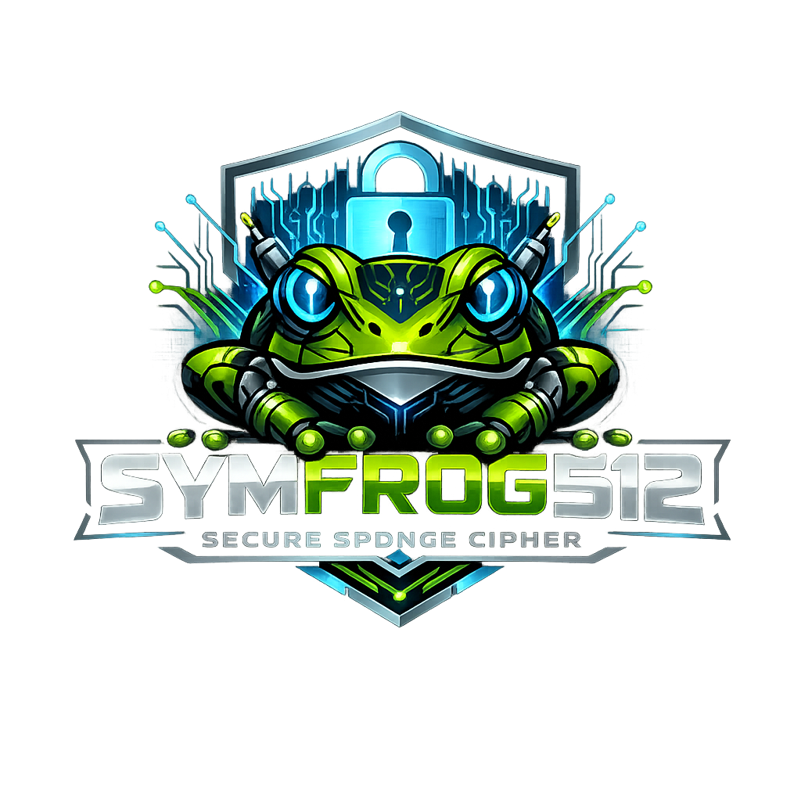

# 🐸 SymFrog-512

**Experimental sponge-duplex AEAD with a 1024-bit state**

<p align="center">
  
</p>

SymFrog-512 is a research implementation of authenticated file encryption built around the custom **P1024-v3** permutation. New encryption writes **AEAD file format v5 (experimental SIV-style)**, with a plaintext-dependent synthetic IV and HKDF-SHA-512 initialization. The P1024-v3 permutation remains unchanged; decryption of historical v1/v2/v3/v4 files is supported. The non-bijective historical P1024-v2 remains available only for reading v1/v2.

> **Important:** SymFrog-512 is a non-standard, independently designed primitive. It has not received the depth of public cryptanalysis enjoyed by AES-GCM, ChaCha20-Poly1305, or Ascon. Use a standardized AEAD for production systems unless an independent review explicitly accepts this risk.

## Current parameters

| Parameter | Value |
|---|---:|
| Permutation state | 1024 bits |
| Rate / capacity | 512 / 512 bits |
| Rounds | 24 |
| Raw key | 1024 bits (128 bytes) |
| Public nonce / synthetic IV | 256 bits each (32 bytes each) |
| Final tag | 256 bits (32 bytes) |
| Stored password salt | 256 bits (32 bytes) |
| File header | 152 bytes |

The large state and tag are conservative parameters, not proof of a particular real-world security level. Security still depends on the structure of P1024-v3, the duplex mode, implementation correctness, nonce discipline, and independent analysis.

## AEAD format v5: synthetic IV and nonce-reuse mitigation (October 2026)

Format `0x00000005` addresses a concrete v4 failure: two **different** plaintexts encrypted with a repeated key + nonce + AAD previously reused the same initial keystream and exposed `C1 XOR C2 = P1 XOR P2` for the initial block. The v5 design is an **experimental SIV-style two-pass composition**, not RFC 5297 AES-SIV or a formally validated nonce-misuse-resistant AEAD. The underlying SymFrog duplex still needs independent security analysis.

**Fields:** The 152-byte header is unchanged. For v5, `salt[32]` contains a public 256-bit nonce (also the Argon2id salt for password mode) and `nonce[32]` contains a 256-bit **synthetic IV**. The `reserved`, `header_tag`, and final 32-byte tag maintain the v4 layout. Unlike v1–v4, raw-key files **must have a nonzero `salt[32]`**. The file version is authenticated.

**Exact v5 computation**, with byte order as in existing serialized headers:

1. Generate a fresh 32-byte public salt/nonce (or honor a deterministic `--nonce-hex` override for tests), and derive the unchanged 128-byte raw or Argon2id key `K`.
2. Derive a 64-byte MAC key using RFC 5869 HKDF-SHA-512: `IKM=K`, `salt=header.salt[32]`, `info=ASCII("SymFrog-512 AEAD v5 | synthetic IV MAC key | HKDF-SHA-512")` (no null terminator).
3. Build `H0`: the 152-byte serialized header with its 32-byte `nonce` and 32-byte `header_tag` **zeroed**, while preserving magic, version, flags, salt, ciphertext length and KDF metadata.
4. Compute `SIV = HMAC-SHA512(K_mac, DOMAIN || H0 || LE64(len(AAD)) || AAD || plaintext)[:32]` where `DOMAIN=ASCII("SymFrog-512 AEAD v5 | SIV transcript | header, AAD, plaintext")`, again without the null terminator. Store it in `header.nonce`.
5. Initialize the unchanged P1024-v3 duplex through 128 bytes of HKDF-SHA-512 using `IKM=K`, `salt=SIV`, `info=ASCII("SymFrog-512 AEAD v5 | P1024-v3 | synthetic IV | HKDF-SHA-512")`, as 16 little-endian 64-bit state words; perform encryption, header authentication, and final-tag calculation as before.
6. During decryption, authenticate the header and ciphertext before writing the destination, decrypt into a protected temporary file, **recompute the SIV over the recovered plaintext** and compare it in constant time before committing the output.

The SIV pass requires reading the plaintext before encryption (two passes). Encrypting the same plaintext with the same key, public nonce/salt and AAD is deterministic; an observer can recognize repeated messages with identical metadata. **Different** plaintexts produce different synthetic IVs assuming the HMAC PRF behaves as intended, so the simple nonce-reuse keystream identity observed in v4 is not reproduced in testing. Security remains conditional on the underlying experimental duplex behaving securely, and must **not** be advertised as provably misuse-resistant.

**Compatibility:** Old ciphertexts of versions 1–4 are read via their exact historical paths. Versions 4 and 5 use distinct HKDF info labels. P1024-v3 (24 rounds, χ, constants) and FrogHash-512 are unchanged. Previous vectors are archival, not new v5 vectors. See `V5_SIV_DESIGN_AND_TESTS.md`.

## Historical AEAD format v4: Key/nonce separation (October 2026)

**Reason:** In v1/v2/v3, the first 1,024-bit keyed state included the last 256 key bits XORed directly with the nonce. For any 256-bit difference `Δ`, replacing the last 256 bits of `K` by `K ⊕ Δ` and `N` by `N ⊕ Δ` yielded exactly the same initial state, ciphertext, and data tag (while authenticated header tags differed). This is a known *related-key/nonce structural identity*, not by itself a demonstrated forgery against an unknown key.

**v4 change (only AEAD initialization):** Use RFC 5869 HKDF with SHA-512 to derive 128 bytes from the 128-byte raw or Argon2id-derived key and the 32-byte nonce. Exact construction:

```
info = ASCII("SymFrog-512 AEAD v4 | P1024-v3 | initial state | HKDF-SHA-512")
PRK  = HMAC-SHA512(key=nonce[32], message=key[128])
T1   = HMAC-SHA512(key=PRK, message=info || 0x01)
T2   = HMAC-SHA512(key=PRK, message=T1 || info || 0x02)
S0   = LE64_words(T1 || T2)       # 16 uint64 words, 128 bytes total
S1   = P1024-v3(S0)
```

`nonce` is public and acts as an HKDF salt; `key` is the input keying material (IKM). HKDF's 512-bit SHA-512 PRK means **this construction does not promise 1,024-bit cryptographic security**, regardless of the raw key size. Effective attack bounds are additionally limited by the 512-bit sponge capacity and the security of the custom design. The 1,280-bit `(K,N)` input is mapped to 1,024 bits: theoretical collisions cannot be eliminated; the demonstrated *simple XOR cancellation* is removed, not all possible related-key weaknesses or nonce-misuse risks.

**Historical v4 compatibility:** The authenticated header version is `0x00000004`, still 152 bytes, with the same payload/tag layout and Argon2id KDF parameters. The 24-round bijective P1024-v3, χ, round constants, sponge transcript and **FrogHash-512** are unchanged. The historical v4 ciphertext vectors remain frozen; old v1/v2/v3 files decrypt using their exact original initialization. The v3 known-answer ciphertext remains a checked legacy fixture. Existing passwords and raw keys can still decrypt old files without conversion. There is no new encryption mode for writing v3 or v4.

**Publication status:** This is an experimental protocol revision requiring an updated paper/specification. Passing regression and avalanche tests is not an independent security proof. For real deployments, prefer a standard AEAD such as XChaCha20-Poly1305 or AES-GCM-SIV.

## P1024-v3 bijectivity fix (October 2026)

**Security finding:** The original P1024-v2 χ used parallel updates on four 64-bit words. The 4-bit inputs `(0,0,0,0)` and `(1,0,1,0)` both mapped to zero, so that layer was not injective. Consequently P1024-v2 was not a permutation, and ideal-permutation-model arguments made for it were inapplicable.

**Fix:** χ now uses four sequential XOR-based nonlinear shears per four-word group, each with an RHS independent of the updated word. Undo the four operations in reverse order to invert χ. Every other layer is bijective (round-constant XOR, XOR mixer, XOR-based kick layer, rotation, and word shuffle), so the composition of 24 rounds is mathematically bijective. `--test-all` exercises the inverse on individual state bits and randomized states.

**Compatibility:** A new `0x00000003` file header selects the new P1024-v3; versions 1 and 2 select the historical algorithm for decryption. Encryptions never write v1/v2. The `hash` command now uses P1024-v3 and a different initial domain label, so **FrogHash-512 digests are not backward-compatible**. Keep old checksums if you need to verify legacy data.

**Scope:** Bijectivity is a necessary property for this permutation, not a cryptographic security proof. The replacement has not undergone independent differential/linear cryptanalysis or an external audit. The paper arXiv:2602.17900v1 and archived statistical results predate this fix; **do not apply old security claims or test vectors to v3**.

## Hardened file-format foundation (v2 and v3)

The changes below were introduced in header version `0x00000002` and remain in v3 (`0x00000003`). Major changes from legacy v1:

- protocol-version separation is injected into the initial state;
- the final padded ciphertext block receives explicit `DS_CT` domain separation;
- all 32 stored salt bytes are committed into the effective Argon2id salt;
- the Argon2id profile is stored in the authenticated header, with explicit opt-in required before honoring SENSITIVE memory cost;
- unknown flags, malformed KDF metadata, non-zero unused fields, and length mismatches are rejected;
- decryption authenticates the full ciphertext **before creating plaintext output** and verifies it again during the decryption pass;
- input symlinks are rejected with `O_NOFOLLOW`;
- existing outputs are not replaced unless `--force` is supplied;
- passphrases can be read from `/dev/tty` or a protected file instead of appearing in process arguments;
- secret files must have mode `0600` or stricter;
- all-zero raw keys are rejected;
- deterministic nonce overrides require an explicit unsafe-use acknowledgement.

Legacy v1, v2, v3 **and v4** decryption are preserved. v1 password files did not encode their Argon2id profile, so `--paranoid` must still be supplied when decrypting a v1 file originally created with the historical SENSITIVE profile.

## Dependencies

Ubuntu / Debian:

```bash
sudo apt update
sudo apt install -y clang lld make pkg-config libsodium-dev libssl-dev python3
```

## Build

The repository includes a `Makefile`. For the current v5 revision, read `V5_SIV_DESIGN_AND_TESTS.md`. `tests/test_v5_siv.py` independently recomputes the synthetic IV with Python HKDF/HMAC, tests nonce reuse and verifies v4 backward decryption. The historical v4 design and KAT are documented separately; the old `tests/historical/test_v4_kat_original_writer.py` targets the archived v4 writer and is not intended to pass against the v5 writer.


```bash
make release
```

CPU-specific optimized build:

```bash
make native
```

Debug and sanitizer builds:

```bash
make debug
make sanitize
```

Manual release build:

```bash
clang++ -std=c++23 -O3 -flto -fuse-ld=lld -fno-rtti \
  -D_FORTIFY_SOURCE=3 -D_GLIBCXX_ASSERTIONS \
  -fstack-protector-strong -fstack-clash-protection -fPIE \
  -Wall -Wextra -Wpedantic -Wshadow -Wconversion -Wsign-conversion -Wformat=2 \
  src/symfrog512.cpp -o symfrog512 \
  -pie -Wl,-z,relro,-z,now -Wl,-z,noexecstack \
  -lsodium -lcrypto
```

The program uses C++ exceptions. Do **not** compile it with `-fno-exceptions`.

## Recommended usage

### Password mode

Prompt securely through `/dev/tty`:

```bash
./symfrog512 enc secret.bin secret.syf --pass-prompt
./symfrog512 dec secret.syf recovered.bin --pass-prompt
```

The encryption prompt asks twice for confirmation. The passphrase is not echoed.

A passphrase file is also supported:

```bash
chmod 600 passphrase.txt
./symfrog512 enc secret.bin secret.syf --pass-file passphrase.txt
./symfrog512 dec secret.syf recovered.bin --pass-file passphrase.txt
```

One trailing LF and optional CR are stripped. An empty passphrase is rejected.

Use the SENSITIVE Argon2id profile for a new file:

```bash
./symfrog512 enc secret.bin secret.syf --pass-prompt --paranoid
```

The selected profile is stored in the authenticated v2/v3/v4/v5 header. Because that metadata cannot be authenticated until after key derivation, decrypting a file that requests the SENSITIVE profile requires an explicit `--paranoid` opt-in. This prevents an attacker-controlled header from silently forcing the highest-memory KDF.

```bash
./symfrog512 dec secret.syf recovered.bin --pass-prompt --paranoid
```

### Raw-key mode

Generate a 128-byte key and protect it carefully:

```bash
umask 077
head -c 128 /dev/urandom > symfrog.key
./symfrog512 enc secret.bin secret.syf --key-file symfrog.key
./symfrog512 dec secret.syf recovered.bin --key-file symfrog.key
```

`--key-file` accepts either exactly 128 raw bytes or exactly 256 hexadecimal characters, with surrounding whitespace ignored in hex mode. Secret files must be mode `0600` or stricter, and an all-zero raw key is rejected as a likely initialization mistake.


### Deterministic public nonce override

Normal encryption generates a fresh random 256-bit public nonce in `salt[32]`, with a content-derived SIV in `nonce[32]`. `--nonce-hex` overrides the **public salt/nonce**, only for reproducible test vectors, and is gated:

```bash
./symfrog512 enc input.bin vector.syf --key-file symfrog.key \
  --nonce-hex 000102030405060708090a0b0c0d0e0f101112131415161718191a1b1c1d1e1f \
  --allow-unsafe-nonce
```

For historical v1–v4 ciphertexts, repeating a nonce under the same key is unsafe. In the experimental v5 writer, repeating a public nonce does not reproduce the same initial keystream for **different** messages under the SIV construction, but identical messages with identical metadata encrypt identically. Prefer fresh random public nonces and a standardized misuse-resistant AEAD for production.

### Associated data

Associated data is hexadecimal and must match during decryption:

```bash
./symfrog512 enc secret.bin secret.syf --pass-prompt --ad 486561646572
./symfrog512 dec secret.syf recovered.bin --pass-prompt --ad 486561646572
```

### Output replacement

SymFrog refuses to overwrite an existing output by default:

```bash
./symfrog512 dec secret.syf recovered.bin --pass-prompt --force
```

`--force` performs an atomic replacement after the new output is completely written and synchronized.

### Legacy argv options

`--pass` and `--key-hex` remain for compatibility, but they may leak secrets through shell history, `/proc`, process monitors, logs, or crash reports. Prefer `--pass-prompt`, `--pass-file`, and `--key-file`.

## File layout

```text
magic[8] | version[4] | flags[4] | salt[32] | nonce[32]
ct_len[8] | reserved[32] | header_tag[32]
ciphertext[ct_len] | final_tag[32]
```

All integers are little-endian. The header tag authenticates the complete header with its tag field zeroed, plus external associated data. In v5, the stored `salt` field is the public nonce (and password KDF salt), and the stored `nonce` field is the computed synthetic IV. In v1–v4 they retain their historical meaning.

For v2/v3 password files, `reserved` is:

```text
"KDF2" | profile[1] | zero[27]
```

Profiles currently accepted:

- `1`: libsodium Argon2id MODERATE
- `2`: libsodium Argon2id SENSITIVE

Raw-key files require both `salt` and `reserved` to be all-zero.

## Tests

Built-in regression and tamper tests:

```bash
./symfrog512 --test-all
```

The suite first verifies χ bijectivity (all 16 4-bit patterns), 1,154 full-state inverse cases and then covers boundary sizes, password and raw-key round trips, wrong key/password, wrong AD, header/ciphertext/tag tampering, and truncation. `make check` additionally runs `tests/test_v3_compatibility.py` against an **original-binary v2 fixture** and a deterministic v3 known-answer vector.

Extended experimental suite:

```bash
make full-suite
./symfrog_full_suite
```

Sanitizer run:

```bash
make sanitize
ASAN_OPTIONS=detect_leaks=1 ./symfrog512-sanitize --test-all
```

## Offline inspector

```bash
python3 src/symfrog_inspect.py path/to/files
python3 src/symfrog_inspect.py --json report.json path/to/files
```

The inspector recognizes v1 through v5, checks structural invariants, and reports visible nonce-reuse risk groups for historical v1–v4 files. A repeated v5 public nonce is not by itself the same keystream-reuse finding. It does **not** possess the key and therefore cannot authenticate or decrypt a file.

## Security model and limitations

SymFrog aims to provide confidentiality and ciphertext integrity when:

- P1024-v3 resists relevant attacks on its permutation and mode;
- historical v1–v4 nonces are never reused under the same key, while v5 follows the synthetic-IV construction and its stated limitations;
- keys and passphrases remain secret;
- the endpoint and operating system are trustworthy;
- implementation and compiler behavior do not introduce exploitable side channels.

It does not protect against endpoint compromise, keyloggers, malicious kernels, RAM acquisition, rollback attacks on external storage, weak human passphrases, or cryptanalytic weaknesses in the custom permutation.

The empirical avalanche tests are sanity checks only. They are not cryptographic proofs. Likewise, ideal-permutation bounds do not establish that P1024-v3 itself behaves ideally.

## Compatibility

- New encryption: **experimental format v5-SIV only**.
- Decryption: **formats v1, v2, v3, v4, and v5** (v1 decoder is not covered by a known original fixture here).
- v3 changed χ and v4/v5 changed the AEAD key and nonce derivation. Older executables cannot read newer ciphertext formats; decrypt and re-encrypt using the new writer for migration.
- FrogHash-512 v3 digests intentionally differ from older digests.
- Do not modify round constants, state layout, padding, domain constants, or extraction rules without defining a new protocol version and publishing new known-answer vectors.

## Files

- `src/symfrog512.cpp`: reference implementation and built-in tests
- `src/symfrog_full_suite.cpp`: extended statistical and robustness experiments
- `src/symfrog_inspect.py`: offline structural inspector
- `SECURITY.md`: security posture and reporting guidance
- `CHANGELOG.md`: changes and migration notes

## License

MIT. See `LICENSE`.

## Author

**Victor Duarte Melo**  
Independent Researcher
